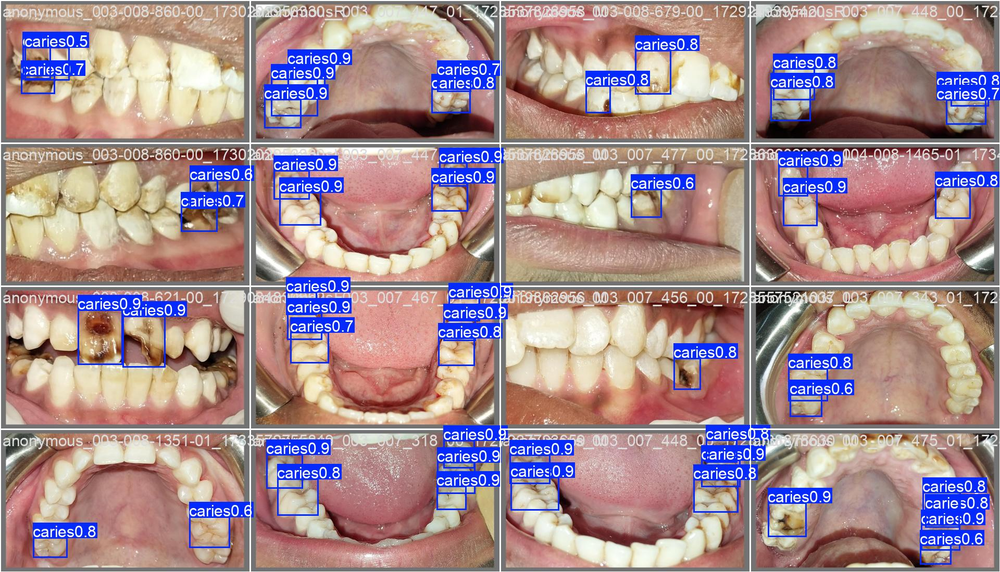
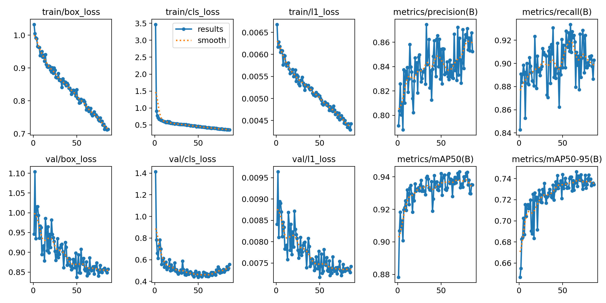

# Dental Caries Detection with YOLO26

Detecting tooth decay (caries) in intraoral phone photos with a YOLO26 object detector.
A computer-vision learning project. **Not a diagnostic tool.**



## Results (held-out test set, 285 images of unseen people)

| Split | Precision | Recall | mAP50 | mAP50-95 |
|---|---|---|---|---|
| Validation | 0.838 | 0.910 | 0.940 | 0.747 |
| **Test** | **0.887** | **0.885** | **0.942** | **0.744** |

**Screening threshold:** `conf = 0.4` → recall 0.928, precision 0.840.
For screening, missing a cavity is worse than a false alarm, so the threshold favors recall.



## Pipeline

1. **Explore** (`02_explore.ipynb`): 6,265 images, of which only 2,227 are annotated. Unlabeled images are excluded, because a missing label doesn't mean healthy.
2. **Clean:** dropped 16 images with out-of-range box coordinates, and merged classes `D` (permanent tooth) and `d` (primary tooth) into one `caries` class.
3. **Split by person, not by image:** each person has up to 5 photo views, so a random image split would leak the same mouth into train and test. Grouped by participant ID (or session timestamp as a fallback); all pilot images go to train. 1,632 / 294 / 285 train / val / test, with 0 people shared between splits.
4. **Train** (`03_train_colab.ipynb`): YOLO26n, pretrained on COCO, imgsz 640, T4 GPU. Early stopping chose epoch 66 of 86.
5. **Evaluate and infer** (`04_inference.ipynb`): one test-set evaluation, confidence-threshold analysis, and a `screen()` function.

## Error analysis
- Some "false positives" look like real lesions the annotators didn't box, so precision is likely understated.
- Several boxes on one tooth, because annotators weren't consistent about one box per tooth vs. one per lesion.
- Misses are mostly small lesions on back teeth, near the image edges.
- Possible confusion between brown staining and decay.

## Limitations
All images come from one phone, one region (Mithi, Sindh), and ages 10–24. Expect lower accuracy on other phones, lighting, and populations (distribution shift).

## Reproduce
```bash
pip install -r requirements.txt
```
Download `Dataset.zip` from [Zenodo](https://zenodo.org/records/14827784), unzip it to `data/raw/`, then run the notebooks in order. Train in Colab, because there's no GPU support on AMD + Windows.

## Dataset and credit
*Annotated intraoral image dataset for dental caries detection*, Scientific Data (2025),
[doi:10.1038/s41597-025-05647-9](https://doi.org/10.1038/s41597-025-05647-9). Licensed CC BY 4.0.